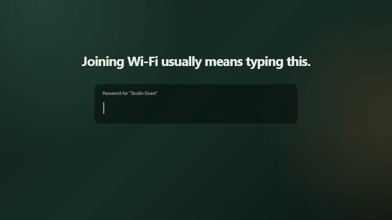
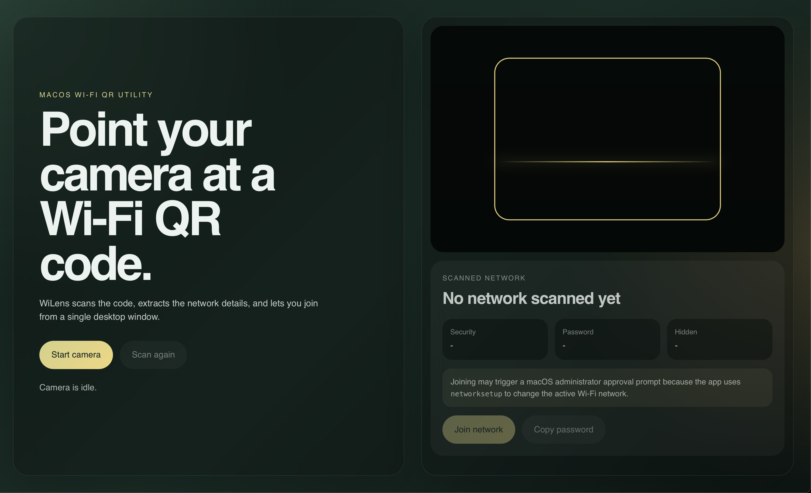

# WiLens

WiLens is a macOS desktop app (with an experimental Windows build) that scans a
Wi-Fi QR code and joins the network.

[](docs/media/wilens-intro.mp4)

## What It Does

1. Opens the camera in a desktop window.
2. Scans a standard Wi-Fi QR code.
3. Shows the network before joining.
4. Joins the network via CoreWLAN — no administrator prompt — and only joins a
   network whose security matches the QR code.
5. Shares a network: type its details to make a Wi-Fi QR code guests can scan,
   and save it as an image. Nothing is stored or sent anywhere.
6. Checks a connection: tests the network link, router, DNS, and internet one
   step at a time, spots sign-in (captive) pages, and explains the result in
   plain language.

Example QR payload:

```txt
WIFI:T:WPA;S:MyWifi;P:mypassword;;
```

## Download

Grab the latest macOS build from the
[Releases page](https://github.com/whereissam/WiLens/releases/latest)
(`WiLens.dmg`). Apple Silicon only.

The app is ad-hoc signed but not notarized, so macOS asks you to confirm the
first launch:

1. Open `WiLens.dmg` and drag **WiLens** into **Applications**.
2. Launch WiLens. When macOS says it can't verify the developer, click **Done**.
3. Open **System Settings → Privacy & Security**, scroll down, click
   **Open Anyway** next to WiLens, and confirm.

If macOS instead says *"WiLens is damaged and can't be opened"* (builds up to
0.1.2), remove the download quarantine flag and open it again:

```sh
xattr -dr com.apple.quarantine /Applications/WiLens.app
```

Each release also lists a `.sha256` checksum next to the download. To check
the file you downloaded:

```sh
shasum -a 256 -c WiLens.dmg.sha256
```

**Windows (x64, experimental):** releases also include `WiLens-setup.exe`,
which joins Wi-Fi through a per-user `netsh wlan` profile (no administrator
prompt). It is unsigned, so SmartScreen asks first — choose **More info → Run
anyway**. WPA3-only networks are not supported yet.

## Current Status

WiLens joins Wi-Fi via CoreWLAN (no administrator prompt), checking that the
network's security matches the QR code and verifying the connection. Open
networks can fall back to `networksetup`. Local builds produce:

- `src-tauri/target/release/bundle/macos/WiLens.app`
- `src-tauri/target/release/bundle/dmg/WiLens_<version>_aarch64.dmg`

## Screenshot



## Run

Open the built app:

```bash
open src-tauri/target/release/bundle/macos/WiLens.app
```

Run the development build:

```bash
bun install
cargo tauri dev
```

Build production again:

```bash
cargo tauri build
```

Published releases get `WiLens.dmg` (with a checksum) from the `macOS build`
workflow, which signs and notarizes it once the `APPLE_*` secrets listed in
`.github/workflows/build-macos.yml` are set. To build the same installer
locally (ad-hoc signed) in one step:

```bash
bun run release:dmg
```

Build the Windows installer (`WiLens-setup.exe`) from a Mac by
cross-compiling. One-time setup:

```bash
brew install nsis llvm lld
cargo install --locked cargo-xwin
rustup target add x86_64-pc-windows-msvc
```

Then:

```bash
bun run release:win
```

The first run downloads the Windows SDK/CRT libraries. This is Tauri's
experimental cross-compile path; release builds come from the `Windows build`
GitHub workflow, which uses a real Windows runner.

## Permissions

- **Camera** — to scan the QR code.
- **Location** — macOS requires Location access before *any* app can scan for
  Wi-Fi networks, so it asks the first time you open WiLens. WiLens uses it only
  to find and join your network; it never collects, stores, or shares your
  location. Granting it lets WiLens join quietly with no administrator prompt.

## Notes

- WiLens targets macOS on Apple Silicon. The Windows (x64) build is experimental.
- Without Location access WiLens cannot check a secured network, so it only
  joins open networks (through the `networksetup` tool, which may show a macOS
  administrator prompt). For secured networks it asks you to allow Location, or
  to copy the password and join from the Wi-Fi menu.
- All permission prompts are controlled by macOS, not by the app UI.

## Security & Privacy

WiLens runs entirely on your Mac — no servers, no accounts, no tracking. Its only
network traffic is the connection check, and only when you click **Run check**: it
pings your router and fetches a tiny page from `captive.apple.com` (Windows:
`www.msftconnecttest.com`), the same address the system uses to detect sign-in
pages. Camera images, network names, and passwords never leave your computer. See [SECURITY.md](SECURITY.md) for the full breakdown and how to
verify it yourself.

## Project Docs

- [Product scope and architecture](docs/product-scope.md)
- [Usage guide](docs/usage.md)
- [Roadmap and TODO](docs/todo.md)
- [Changelog](CHANGELOG.md)

## Contributing

Contributions are welcome: see [CONTRIBUTING.md](CONTRIBUTING.md) for setup,
checks, and project principles. Issues labelled
[`good first issue`](https://github.com/whereissam/WiLens/labels/good%20first%20issue)
are a good place to start.

- [Release Testing Manual](docs/testing.md) – Step-by-step physical device testing checklist across macOS and Windows.

## License

[MIT](LICENSE) © whereissam
